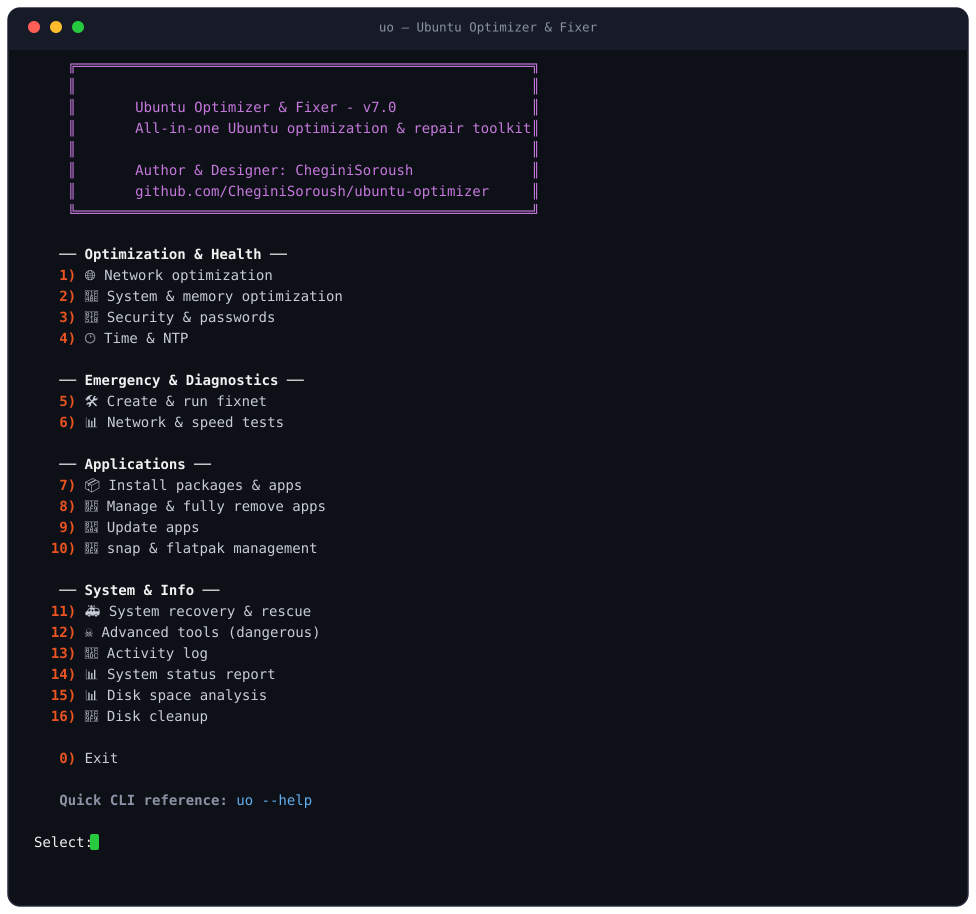

<div align="center">
  <a href="https://github.com/CheginiSoroush/ubuntu-optimizer">
    
  </a>

# Ubuntu Optimizer &amp; Fixer

**یک دستور؛ اوبونتویی سریع‌تر، تمیزتر و سالم‌تر.**

جعبه‌ابزار همه‌کارهٔ بهینه‌سازی، مدیریت برنامه‌ها و تعمیر اوبونتو —
۱۷ ابزار در منویی ساده، بیش از ۳۵ گزینهٔ خط فرمان و پیش‌نمایش صادقانهٔ dry-run.

[](https://github.com/CheginiSoroush/ubuntu-optimizer/actions/workflows/lint.yml)
[](https://cheginisoroush.github.io/ubuntu-optimizer/)
[](CHANGELOG.md)
[](LICENSE)


[English](README.md) · [فارسی](README.fa.md)

</div>

<p align="center">
  
</p>

---

## ✨ چه چیزهایی به دست می‌آورید؟

| حوزه | قابلیت‌ها |
|---|---|
| 🌐 **شبکه** | کنترل ازدحام BBR · DNS سریع (8.8.8.8 / 1.1.1.1) · تنظیم خودکار MTU · تنظیم کامل TCP (fastopen و بافرهای ۱۶ مگابایتی) · خاموش‌کردن صرفه‌جویی انرژی Wi-Fi |
| 💾 **سیستم و حافظه** | swappiness و vfs_cache_pressure · noatime (بلافاصله با remount اعمال می‌شود) · preload · TLP · محدودکردن حجم ژورنال |
| 🔐 **امنیت** | تمدید timeout سودو · قاعدهٔ polkit اختیاری (فقط نشست‌های محلی، همراه با هشدار شفاف) |
| 🕐 **زمان** | همگام‌سازی با chrony به‌همراه راه‌حل اضطراری مستقل |
| 🛠 **fixnet** | اسکریپت مستقل دوزبانه که پس از قطع‌شدن VPN اتصال را تعمیر می‌کند — resolv.conf را بازمی‌گرداند و *منتظر بازگشت شبکه می‌ماند* |
| 💿 **دیسک** | تحلیل مصرف فضا بر اساس دسته‌بندی + پاک‌سازی با یک دستور (کش apt، ژورنال، کرنل‌های قدیمی، نسخه‌های snap، گزارش‌های کرش) |
| 📊 **عیب‌یابی** | ping، DNS، تست سرعت اینترنت · گزارش وضعیت سیستم فقط-خواندنی · گزارش JSON ماشین‌خوان (`--report --json`) · لاگ سری‌زمانی JSONL (`--report --json --append --output`, v7.7) |
| 📦 **نصب** | بسته‌های deb · **نصب هوشمند tar.gz/tgz** (تشخیص فایل اجرایی اصلی، بررسی معماری، نصب خودکار وابستگی‌ها) · AppImage |
| 🐙 **GitHub Releases** | نصب / به‌روزرسانی / حذف برنامه‌ها — انتخاب خودکار فایل سازگار با معماری سیستم · **بررسی checksum شی‌آر-۲۵۶** وقتی ریلیز فایل checksum دارد (v7.4) |
| ⬆ **به‌روزرسانی خود ابزار** | `uo --self-update` — خود ابزار خودش را به‌روز می‌کند: بررسی نسخه از مخزن رسمی، git pull برای کلون‌ها، آرشیو تأییدشده + پشتیبان خودکار برای کپی‌های ثابت (v7.6) |
| 🧹 **حذف کامل** | حذف کامل هر برنامه از **هر منبعی** (apt / snap / flatpak / tar.gz / دستی) — به‌همراه داده‌های کاربر |
| 🔄 **به‌روزرسانی** | apt + snap + flatpak + tar.gz + GitHub در یک دستور، با `-y` کاملاً خودکار |
| 🚑 **بازیابی** | تعمیر بسته‌های خراب، نصب مجدد محیط دسکتاپ |
| 📜 **گزارش‌گیری** | ثبت هر عملکرد در گزارش، با خلاصه‌ای شفاف در پایان هر اجرا |

> 💡 حوصله به‌خاطر‌سپردن فلگ‌ها را ندارید؟ فقط `uo` را اجرا کنید و از منو انتخاب کنید.
> ترمینال جان خانه‌تان است؟ همهٔ امکانات یک فلگ فاصله دارند — `uo --help`.

---

## ⚡ شروع سریع

```bash
git clone https://github.com/CheginiSoroush/ubuntu-optimizer.git
cd ubuntu-optimizer
./install.sh          # بررسی سلامت + دستور `uo` + تنظیم PATH + تکمیل خودکار bash
source ~/.bashrc      # یک‌بار — ترمینال‌های جدید خودکار آماده‌اند
```

```bash
uo                    # منوی تعاملی
uo --report           # گزارش سیستم (فقط خواندن)
uo --report --json | jq '.summary'   # همان گزارش، خروجی ماشین‌خوان (v7.5)
uo --report --json --append --output ~/.local/share/ubuntu-optimizer/report-log.jsonl
                      # هر بار اجرا یک خط JSON → لاگ سری‌زمانی برای داشبوردها (v7.7)
uo --self-update      # خود ابزار را روی آخرین نسخه نگه دارید (v7.6)
uo --optimize --dry-run -y   # پیش‌نمایش همه‌چیز قبل از هر تغییری
```

**پیش‌نیازها:** اوبونتو ۲۰٫۰۴ به بالا (سایر توزیع‌های مبتنی بر Debian هم کار می‌کنند) · Bash 4.3+ · `sudo`
**اختیاری:** `jq` (پارس سریع‌تر GitHub API — بدون آن هم همه‌چیز کار می‌کند) · [`GH_TOKEN`](#-توکن-اختیاری-github-api)

> ⚠️ دستور `uo` را **بدون sudo** اجرا کنید — خودش فقط زمانی که عملیاتی واقعاً نیاز داشته باشد، رمز sudo را می‌خواهد.

<details>
<summary><b>📦 مدیریت نصب</b> (به‌روزرسانی / حذف / بررسی سلامت)</summary>

```bash
./install.sh --check       # سلامت فایل‌ها و وضعیت نصب (کد خروج مناسب CI)
./install.sh --update      # به‌روزرسانی از git (اگر پوشه مخزن git باشد)
./install.sh --uninstall   # حذف میان‌بر، alias و تکمیل خودکار — فایل‌های پروژه می‌مانند
```
</details>

---

## ⚡ پروفایل‌ها — یک فلگ برای کل سناریو

به‌جای حفظ‌کردن مراحل، وضعیت خود را انتخاب کنید — هر پروفایل زیرمجموعه‌ای
ایمن و منتخب از بهینه‌ساز را اجرا می‌کند (اول برنامه نمایش داده می‌شود و با
`uo --undo` قابل بازگشت است):

| پروفایل | اجرا می‌شود | عمداً حذف شده |
|---|---|---|
| `laptop` | حافظه · noatime · TLP · BBR/TCP · خاموشی powersave وای‌فای · سقف ژورنال | preload |
| `server` | حافظه · noatime · سقف ژورنال · BBR/TCP · خاموشی سرویس‌های اضافه | TLP، مراحل وای‌فای، preload |
| `gaming` | حافظه · BBR/TCP · خاموشی powersave وای‌فای · سقف ژورنال | noatime، سرویس‌ها، نصب‌ها |
| `minimal` | حافظه · سقف ژورنال · خاموشی سرویس‌های اضافه | بقیهٔ موارد — هیچ چیزی نصب نمی‌شود |

```bash
uo --profile laptop --dry-run -y   # اول پیش‌نمایش دقیق برنامه
uo --profile server -y             # اعمال بدون سؤال
```

---

## 🌐 وب‌سایت — میزبانی‌شده روی GitHub Pages

این پروژه یک صفحهٔ معرفی دوزبانه (فارسی / English) هم دارد — با پشتیبانی کامل RTL/LTR،
تم روشن و تاریک و دموی ترمینال انیمیشنی — که با Next.js 16 و Tailwind CSS 4 ساخته شده
و **به‌صورت رایگان روی GitHub Pages** میزبانی می‌شود:

> **🔗 https://cheginisoroush.github.io/ubuntu-optimizer/**

- سورس در پوشهٔ [`website/`](website) است و هر تغییری در آن با
  [`.github/workflows/website.yml`](.github/workflows/website.yml) به‌صورت خودکار build و منتشر می‌شود
- تنها تنظیم لازم پس از ساخت مخزن: **Settings → Pages → Source → GitHub Actions**
- بدون سرور، بدون دیتابیس، بدون هزینه — خروجی کاملاً استاتیک (`output: 'export'`)

راهنمای اجرای محلی و build دستی: [`website/README.md`](website/README.md).

---

## 🖥 منوی تعاملی — ۱۷ ابزار، بدون نیاز به حفظ‌کردن هیچ‌چیز

| # | ابزار | چه کاری می‌کند |
|:--:|---|---|
| 1 | 🌐 بهینه‌سازی شبکه | BBR، DNS، MTU، تنظیم TCP، مدیریت انرژی Wi-Fi |
| 2 | 💾 بهینه‌سازی سیستم و حافظه | swappiness، noatime، preload، TLP، محدودکردن ژورنال |
| 3 | 🔐 امنیت و گذرواژه‌ها | timeout سودو + تنظیمات polkit |
| 4 | 🕐 زمان و NTP | همگام‌سازی ساعت سیستم |
| 5 | ⚡ پروفایل‌های بهینه‌سازی | پیش‌تنظیم‌های منتخب: laptop · server · gaming · minimal |
| 6 | 🛠 ساخت و اجرای fixnet | ساخت اسکریپت مستقل تعمیر شبکه |
| 7 | 📊 تست‌های شبکه و سرعت | ping، DNS، سرعت، اطلاعات کامل شبکه |
| 8 | 📦 نصب بسته‌ها و برنامه‌ها | deb · tar.gz · GitHub Releases · AppImage |
| 9 | 🧹 مدیریت و حذف کامل برنامه‌ها | هر برنامه‌ای، از هر منبعی، شامل داده‌های کاربر |
| 10 | 🔄 به‌روزرسانی برنامه‌ها | همهٔ منابع در یک مرحله |
| 11 | 🧩 مدیریت snap و flatpak | فهرست، نصب، حذف، پاک‌سازی نسخه‌ها |
| 12 | 🚑 بازیابی و نجات سیستم | بسته‌های خراب، نصب مجدد دسکتاپ، `--undo` |
| 13 | ☠ ابزارهای پیشرفته *(خطرناک)* | با جدا‌سازی واضح و هشدارهای صریح |
| 14 | 📜 گزارش فعالیت | چه اتفاقی، کِی افتاده است |
| 15 | 📊 گزارش وضعیت سیستم | عکس‌برداری فقط-خواندنی از سلامت و بهینه‌سازی‌ها |
| 16 | 📊 تحلیل فضای دیسک | گیگابایت‌های شما کجا رفته‌اند |
| 17 | 🧹 پاک‌سازی دیسک | پس‌گرفتنشان |

---

## ⌨ حالت خط فرمان — برای اسکریپت‌ها و اهالی ترمینال

| دستور | کار |
|---|---|
| `uo --optimize` | همهٔ بهینه‌سازی‌های شبکه + سیستم |
| `uo --network` / `--system` / `--security` / `--time` | فقط یک حوزه |
| `uo --undo` | **برگرداندن همه‌چیز** با یک دستور — هر چه بهینه‌ساز تغییر داده |
| `uo --profile laptop\|server\|gaming\|minimal` | اعمال پیش‌تنظیم منتخب برای سناریوی شما |
| `uo --dry-run` | **پیش‌نمایش** دستورات بدون اجرا (به‌همراه شش گزینهٔ بالا) |
| `uo --self-update` | به‌روزرسانی خودِ ابزار — git pull یا آرشیو تأییدشده، با پشتیبان و بازگشت (v7.6) |
| `uo --report` · `--report --json` · `--disk` | گزارش وضعیت · گزارش JSON برای اتوماسیون · تحلیل دیسک · پاک‌سازی |
| `uo --report --json --output FILE [--append]` | نوشتن گزارش در فایل — `--append` یک لاگ سری‌زمانی JSONL برای داشبوردها می‌سازد (v7.7) |
| `uo --doctor` | بررسی سلامت و تعمیر همهٔ برنامه‌های نصب‌شده/ردیابی‌شده |
| `uo --github-install OWNER/REPO [NAME]` | نصب برنامه از آخرین ریلیز GitHub |
| `uo --github-update` · `--github-list` · `--github-remove` | به‌روزرسانی · فهرست · حذف برنامه‌های GitHub |
| `uo --install-targz FILE [NAME]` | نصب هوشمند از فایل tar.gz (نام خودکار پیدا می‌شود) |
| `uo --cleanup NAME` (`--purge-data`) | حذف کامل یک برنامه از هر منبعی |
| `uo --update` · `--update-apt/snap/flatpak/targz` | به‌روزرسانی همه یا یک منبع |
| `uo --list-apps` · `--snap-clean` | فهرست برنامه‌ها · پاک‌سازی نسخه‌های قدیمی snap |
| `uo --fixnet` · `--fixnet-run` · `--test` | ساخت · اجرای fixnet · تست‌های شبکه |
| `uo --git-ssh` · `--git-ssh-status` | ویزارد کلید SSH گیت‌هاب · وضعیت |
| `uo --log` · `--log-clear` | نمایش · حذف گزارش فعالیت |
| `uo -y` · `--no-color` · `--no-log` | تأیید خودکار · خروجی ساده · ثبت‌نکردن گزارش |

### مثال‌های واقعی

```bash
uo --optimize                                    # بعد از یک نصب تازهٔ اوبونتو
uo --optimize --dry-run -y                       # احتیاط دارید؟ اول همهٔ دستورات را ببینید
uo --update -y                                   # همه‌چیز را بدون هیچ سؤالی به‌روز کن
uo --install-targz ~/Downloads/app.tar.gz myapp  # نصب از آرشیو
uo --github-install junegunn/fzf                 # نصب از ریلیز GitHub
uo --cleanup abdownloadmanager --purge-data -y   # حذف یک برنامه بدون هیچ ردی
uo --doctor                                      # بررسی سلامت و تعمیر برنامه‌ها
```

---

## 🧠 چرا هوشمند به نظر می‌رسد؟

<details open>
<summary><b>نصب هوشمند tar.gz</b> — مراحل کار</summary>

1. آرشیو باز می‌شود و **فایل اجرایی اصلی تشخیص داده می‌شود** (اولویت: AppImage → تطابق نام → تنها گزینه → انتخاب دستی) — فایل‌های کمکی Electron/JVM مثل `chrome_crashpad_handler` و `jspawnhelper` خودکار نادیده گرفته می‌شوند
2. **معماری بسته** با سیستم شما مقایسه می‌شود — دانلودهای اشتباه (مثلاً arm64 روی x86_64) *قبل از نصب* شناسایی می‌شوند
3. **وابستگی‌های غایب** با `ldd` پیدا و خودکار نصب می‌شوند
4. برنامه در `/opt/<name>` با میان‌بر ترمینال و فایل `.desktop` استاندارد نصب می‌شود
5. در **رجیستری** ثبت می‌شود — تا به‌روزرسانی‌ها آن را پیدا کنند و حذف، همهٔ ردها را پاک کند

</details>

<details>
<summary><b>حذف کامل</b> — هر منبعی، هر ردی</summary>

همهٔ منابع جست‌وجو می‌شوند: رجیستری، apt (دقیق و فازی)، snap، flatpak، پوشه‌های `/opt` و فایل‌های desktop. مالکیت deb پوشه‌های `/opt` (مثل Obsidian) تشخیص داده می‌شود تا حذف از **مسیر درست** (apt) انجام شود. با `--purge-data` پوشه‌های داده/پیکربندی کاربر هم حذف می‌شوند — پوشه‌های پایه مثل `~/.config` هرگز پیشنهاد نمی‌شوند.

</details>

<details>
<summary><b>داکتر (Doctor)</b> — معاینهٔ سلامت هر چیزی که این ابزار نصب کرده</summary>

`uo --doctor` همهٔ برنامه‌های ردیابی‌شده را بررسی می‌کند: وجود فایل‌ها، فرمت و مجوزهای باینری، سالم‌بودن symlinkها، درستی desktop entry (شامل wrapper ترمینال) و بارگذاری‌شدن وابستگی‌ها — و هرچه بتواند تعمیر می‌کند.

</details>

---

## 🛡 ایمنی در اولویت است

این ابزار تنظیمات سیستم را تغییر می‌دهد — برای همین طوری ساخته شده که **قابل بازگشت و صادق** باشد:

- 🔍 **پیش‌نمایش dry-run** — دستور `uo --optimize --dry-run` *هر دستوری* را که قرار است اجرا شود چاپ می‌کند. همان چیزی که می‌بینید، دقیقاً همان است که اجرا می‌شود.
- 💾 **پشتیبان‌گیری خودکار** — قبل از ویرایش noatime از `/etc/fstab.bak` ساخته می‌شود؛ ویرایش‌های sudoers در فایلی جداگانه با `visudo -c -f` اعتبارسنجی و در صورت خطا خودکار حذف می‌شوند.
- ⚠️ **هشدار قبل از تغییرات پرخطر** — غیرفعال‌کردن avahi-daemon چاپگرهای شبکه (mDNS) را می‌شکند؛ قاعدهٔ polkit امنیت را کمی پایین می‌آورد؛ تغییر DNS اتصال را قطع می‌کند (**روی SSH اجرا نکنید**) — همه از قبل اعلام می‌شوند.
- 🧹 **نام‌های پاک‌سازی‌شده** — نام برنامه‌ها قبل از هر عملیاتی sanitize می‌شوند؛ مسیرهای حساس (`/`، `/opt`، `$HOME`…) از حذف مسدودند.
- ✅ **تأیید به‌صورت پیش‌فرض** — عملیات‌های مخرب همیشه سؤال می‌کنند (مگر با `-y`).
- 📖 **حالت فقط-خواندنی** — `--report` و `--disk` هیچ چیزی را تغییر نمی‌دهند.

<details>
<summary><b>↩️ بازگرداندن تغییرات</b> — یک دستور، یا هر فایل به‌صورت دستی</summary>

**راه آسان — نسخهٔ 7.2 به بعد:**

```bash
uo --undo                 # برنامهٔ تغییرات را نشان می‌دهد، تأیید می‌گیرد و برمی‌گرداند:
                          # فایل‌های drop-in، پشتیبان fstab، سرویس‌های غیرفعال‌شده و
                          # تنظیمات DNS / مدیریت انرژی وای‌فای
uo --undo --dry-run -y    # اول پیش‌نمایش برنامهٔ تغییرات
```

**راه دستی (همهٔ نسخه‌ها):**

```bash
# پارامترهای کرنل/شبکه (BBR، swappiness، TCP و…)
sudo rm /etc/sysctl.d/99-ubuntu-optimizer.conf && sudo sysctl --system

# fstab (noatime) — بازگرداندن پشتیبان خودکار
sudo cp /etc/fstab.bak /etc/fstab

# محدودیت حجم ژورنال
sudo rm /etc/systemd/journald.conf.d/99-optimizer.conf

# timeout سودو / قاعدهٔ polkit
sudo rm /etc/sudoers.d/99-optimizer-timeout
sudo rm /etc/polkit-1/rules.d/10-disable-password-timeout.rules

# فعال‌سازی مجدد سرویس‌های اختیاری
sudo systemctl enable --now cups-browsed whoopsie avahi-daemon

# سپس یک‌بار ریبوت (یا remount /) برای تغییر fstab.
```

DNS و MTU تنظیمات سطح اتصال (NetworkManager) هستند — از تنظیمات شبکه برگردانید یا گزینهٔ منو را دوباره با مقادیر دلخواه اجرا کنید.

</details>

### 📍 فایل‌ها و مسیرهای ایجادشده یا تغییریافته

| مسیر | کاربرد |
|---|---|
| `/etc/sysctl.d/99-ubuntu-optimizer.conf` | پارامترهای کرنل (BBR، swappiness و…) |
| `/etc/systemd/journald.conf.d/99-optimizer.conf` | محدودیت حجم ژورنال |
| `/etc/sudoers.d/99-optimizer-timeout` | timeout سودو (۱۲۰ دقیقه) |
| `/etc/polkit-1/rules.d/10-disable-password-timeout.rules` | قاعدهٔ polkit (فقط با رضایت کاربر) |
| `/opt/<name>` | محل نصب برنامه‌های tar.gz |
| `~/.local/share/ubuntu-optimizer/apps.db` | رجیستری برنامه‌های tar.gz |
| `~/.local/share/ubuntu-optimizer/github.db` | بانک اطلاعاتی برنامه‌های GitHub |
| `~/.local/state/ubuntu-optimizer/optimizer.log` | گزارش فعالیت |
| `~/fix-network.sh` | اسکریپت fixnet + alias پوسته |
| `~/.local/bin/uo` | میان‌بر اجرا |

---

## 🐙 توکن اختیاری: GitHub API

دستورات `--github-update` و `--github-install` از GitHub API استفاده می‌کنند که محدود به
**۶۰ درخواست در ساعت برای هر IP** است — سهمی که بین همهٔ کاربران پشت NAT ارائه‌دهندهٔ اینترنت شما تقسیم می‌شود.
یک توکن شخصی این سقف را به **۵٬۰۰۰ در ساعت** می‌رساند:

1. یک توکن کلاسیک فقط-خواندنی بسازید: github.com → Settings → Developer settings →
   Personal access tokens → *Generate new token (classic)* — **بدون نیاز به هیچ اسکوپی**.
2. آن را به پوستهٔ خود اضافه کنید:

```bash
echo 'export GH_TOKEN="ghp_your_token"' >> ~/.bashrc
source ~/.bashrc
```

هر دو متغیر `GH_TOKEN` و `GITHUB_TOKEN` پشتیبانی می‌شوند. توکن فقط به `api.github.com`
ارسال می‌شود و هرگز در گزارش ثبت نمی‌شود.

---

## 🌐 اختیاری: سرورهای DNS سفارشی

بهینه‌سازی شبکه (`--network` و `--optimize`) به‌طور پیش‌فرض DNS را روی
`8.8.8.8` و `1.1.1.1` تنظیم می‌کند. اگر ISP یا منطقهٔ شما با این سرورها مشکل دارد،
می‌توانید سرورهای دلخواه خودتان را تعیین کنید:

```bash
echo 'export UO_DNS_SERVERS="1.1.1.1 9.9.9.9"' >> ~/.bashrc
source ~/.bashrc
```

- فقط **آدرس‌های IPv4** جدا شده با فاصله؛ مقدار نامعتبر قبل از هر تغییری رد می‌شود.
- اسکریپت تعمیر شبکه (`fixnet`) هم از همین متغیر استفاده می‌کند (هم در پیش‌نمایش و هم در resolv.conf پشتیبان).

---

## 📁 ساختار پروژه

```
ubuntu-optimizer/
├── ubuntu-optimizer.sh        ← تنها فایلی که اجرا می‌کنید (CLI + منو)
├── install.sh                 ← نصب / به‌روزرسانی / حذف خود ابزار
├── completions/uo             ← تکمیل خودکار bash برای دستور uo
├── docs/                      ← لوگو و تصاویر README (SVG)
├── lib/
│   ├── common.sh              ← رنگ‌ها، توابع کمکی، رجیستری، گزارش‌گیری
│   ├── network.sh             ← بهینه‌سازی و تست‌های شبکه
│   ├── system.sh              ← سیستم، حافظه، امنیت، زمان
│   ├── fixnet.sh              ← ساخت و اجرای اسکریپت دوزبانهٔ fixnet
│   ├── packages.sh            ← نصب بسته‌های deb و ابزارها
│   ├── targz.sh               ← نصب‌کنندهٔ هوشمند tar.gz + AppImage
│   ├── github.sh              ← نصب/به‌روزرسانی از GitHub Releases
│   ├── appmgmt.sh             ← حذف کامل برنامه‌ها از همهٔ منابع
│   ├── snapflatpak.sh         ← مدیریت snap/flatpak و به‌روزرسانی‌ها
│   ├── recovery.sh            ← بازیابی سیستم + ابزارهای پیشرفته
│   ├── undo.sh                ← برگرداندن همهٔ بهینه‌سازی‌ها با یک دستور
│   ├── profile.sh             ← پیش‌تنظیم‌های منتخب: laptop / server / gaming / minimal
│   ├── selfupdate.sh          ← ‪--self-update‬: بررسی نسخه + به‌روزرسانی git/آرشیو
│   ├── report.sh              ← گزارش وضعیت سیستم
│   ├── jsonreport.sh          ← همان گزارش در قالب یک سند JSON
│   ├── doctor.sh              ← بررسی سلامت و تعمیر برنامه‌ها
│   ├── disk.sh                ← تحلیل فضای دیسک و پاک‌سازی
│   ├── gitssh.sh              ← راه‌اندازی SSH گیت‌هاب
│   └── menus.sh               ← موتور منو و همهٔ منوها
├── test/                      ← تست‌های واحد bats (common، appmgmt، github، undo، profile، jsonreport، selfupdate، reportfile، syntax)
├── completions/               ← uo (bash) · ‪_uo‬ (zsh) — تکمیل تب برای همهٔ فلگ‌ها
├── .github/workflows/
│   ├── lint.yml               ← CI: shellcheck + syntax + bats در هر push
│   └── website.yml            ← CI: build و انتشار وب‌سایت روی GitHub Pages
├── website/                   ← سایت دوزبانه (Next.js 16) → GitHub Pages
├── README.md · README.fa.md · CHANGELOG.md · CONTRIBUTING.md · SECURITY.md · LICENSE
└── .shellcheckrc              ← پیکربندی lint پروژه
```

> فایل‌های `lib/` را مستقیم اجرا نکنید — همیشه از طریق `ubuntu-optimizer.sh` (یا `uo`) کار کنید.

---

## 🧪 مثل یک محصول واقعی تست می‌شود

| گیت کیفیت | وضعیت |
|---|---|
| بررسی سینتکس `bash -n` | ✅ هر ۲۲ فایل شل |
| ShellCheck (سخت‌گیرانه) | ✅ صفر ایراد — در CI اجباری است |
| تست‌های واحد bats | ✅ ۱۰۴ از ۱۰۴ پاس |
| `install.sh --check` | ✅ خودارزیابی سلامت داخلی |
| GitHub Actions CI | ✅ روی هر push و pull request |

اجرای کامل گیت‌های کیفیت به‌صورت محلی:

```bash
sudo apt install shellcheck bats   # یک‌بار
bats test/
shellcheck -x ubuntu-optimizer.sh install.sh lib/*.sh
bash install.sh --check
```

---

## ❓ سؤالات متداول

<details>
<summary><b>اجرای آن ایمن است؟</b></summary>

هر بهینه‌سازی در یک **فایل مستقل قابل‌حذف** نوشته می‌شود، نه در تنظیمات اصلی سیستم. پشتیبان‌ها خودکار ساخته می‌شوند (`fstab.bak`)، ویرایش‌های sudoers قبل از فعال‌شدن اعتبارسنجی می‌شوند، عملیات‌های پرخطر هشدار و تأیید می‌خواهند و `--dry-run` *دقیقاً* نشان می‌دهد چه اتفاقی قرار است بیفتد. بخش [ایمنی در اولویت است](#-ایمنی-در-اولویت-است) را ببینید.

</details>

<details>
<summary><b>کدام توزیع‌ها پشتیبانی می‌شوند؟</b></summary>

برای اوبونتو (۲۰٫۰۴ به بالا) طراحی و تست شده است. سایر توزیع‌های خانوادهٔ Debian معمولاً کار می‌کنند — قابلیت‌های شبکه به NetworkManager (`nmcli`) نیاز دارند که در نصب‌های دسکتاپ استاندارد است.

</details>

<details>
<summary><b>می‌توانم همه‌چیز را برگردانم؟</b></summary>

بله — بخش [بازگرداندن تغییرات](#️-بازگرداندن-تغییرات) را ببینید. هر فایلی که ابزار می‌سازد در [فایل‌ها و مسیرها](#-فایل-ها-و-مسیرهای-ایجادشده-یا-تغییریافته) فهرست شده؛ آن‌ها را حذف و ریبوت کنید.

</details>

<details>
<summary><b>چرا دربارهٔ SSH هشدار می‌دهد؟</b></summary>

مراحل DNS و صرفه‌جویی انرژی Wi-Fi اتصال شبکه را ری‌استارت می‌کنند. اگر با SSH به ماشین وصل باشید، نشست شما قطع می‌شود. ابزار این را تشخیص داده و قبل از اجرا هشدار می‌دهد.

</details>

<details>
<summary><b>آیا به اینترنت نیاز دارد؟</b></summary>

فقط برای نصب/به‌روزرسانی بسته‌ها و تست‌های شبکه. همهٔ بهینه‌سازی‌ها، گزارش‌ها، تحلیل دیسک و مدیریت برنامه‌ها آفلاین کار می‌کنند.

</details>

<details>
<summary><b>English version?</b></summary>

Yes! The full English documentation lives here: [README.md](README.md). fixnet is bilingual at runtime (English/Persian, auto-detected).

</details>

<details>
<summary><b>تازگی‌های نسخهٔ ۷٫۰؟</b></summary>

- لایسنس MIT + زیرساخت کامل مخزن: CI، قالب‌های issue/PR، سیاست مشارکت و امنیت
- توابع پراستفاده حدود ۱۰۰ برابر سریع‌تر (`normalize_name` و دوستانش — بدون پروسهٔ اضافه)
- پیش‌نمایش‌های dry-run صادقانه (خداحافظ موفقیت‌های ساختگی!)
- دستورهای جدید `--doctor`، `--disk` و `--disk-clean` · قابلیت دیسک در منو
- ۶ تست bats جدید · ShellCheck تمیز در کل پروژه

تاریخچهٔ کامل: [CHANGELOG.md](CHANGELOG.md)

</details>

---

## 🗺 نقشه راه

- [x] CI با GitHub Actions (shellcheck + syntax + bats)
- [x] پشتیبانی از توکن GitHub API (`GH_TOKEN` / `GITHUB_TOKEN`)
- [x] تکمیل خودکار bash برای گزینه‌های CLI
- [x] تست‌های خودکار (bats) برای `lib/common.sh`
- [x] حالت `--dry-run`
- [x] نسخهٔ ۷٫۰: زیرساخت مخزن (لایسنس، CI، قالب‌ها، تاریخچه تغییرات)
- [ ] تکمیل خودکار zsh
- [ ] پوشش bats برای همهٔ ماژول‌های `lib/`
- [ ] چارچوب ترجمه (fa / زبان‌های بیشتر)

---

## 🤝 مشارکت · 🔒 گزارش ایراد

- باگ پیدا کردید یا ایده‌ای دارید؟ [یک issue باز کنید](https://github.com/CheginiSoroush/ubuntu-optimizer/issues) — قالب‌های آماده در اختیار شماست
- می‌خواهید روی ابزار کار کنید؟ [CONTRIBUTING.md](CONTRIBUTING.md) راهنمای کامل راه‌اندازی، قوانین و چک‌لیست PR است
- نگرانی‌های امنیتی: [SECURITY.md](SECURITY.md) را ببینید — برای این‌ها issue عمومی باز **نکنید**
- تاریخچهٔ همهٔ نسخه‌ها: [CHANGELOG.md](CHANGELOG.md)

---

<div align="center">

## 👤 نویسنده

**سروش چگینی** · [@CheginiSoroush](https://github.com/CheginiSoroush)

<a href="https://github.com/CheginiSoroush">
  
</a>

<br/>

اگر `uo` اوبونتوی شما را سریع‌تر و تمیزتر کرد، یک ⭐ بهترین تشویق است!

[](https://github.com/CheginiSoroush/ubuntu-optimizer/stargazers)
[](https://github.com/CheginiSoroush/ubuntu-optimizer/network/members)

<br/>

با ❤️ و Bash خالص ساخته شده · [MIT](LICENSE) © Soroush Chegini

</div>
